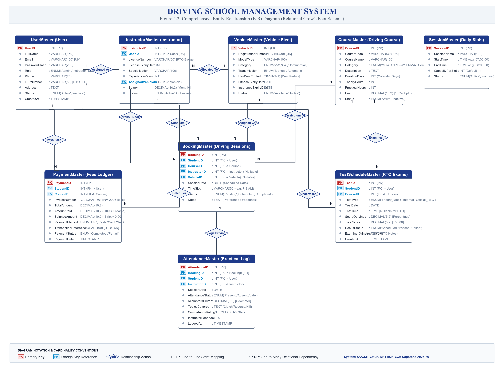
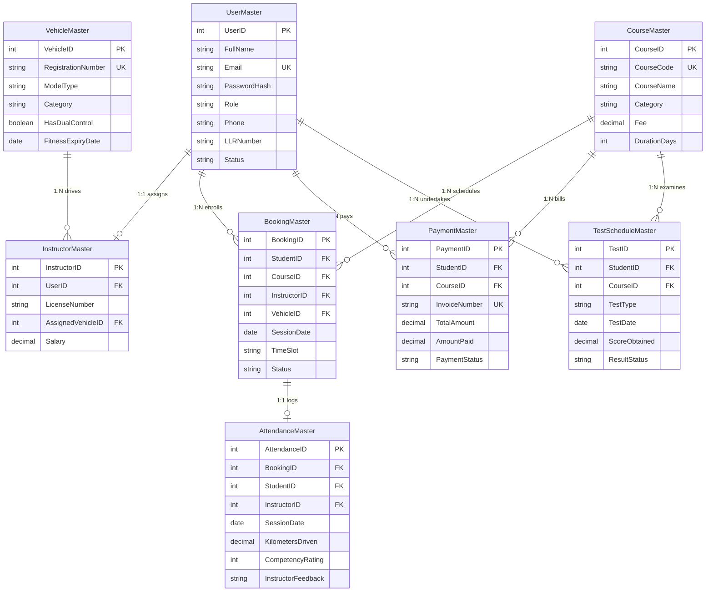

# Royal Education Society's
## COLLEGE OF COMPUTER SCIENCE AND INFORMATION TECHNOLOGY, LATUR
### Affiliated to Swami Ramanand Teerth Marathwada University, Nanded

---

# A Project Report on
# **DRIVING SCHOOL MANAGEMENT SYSTEM**

### Submitted for the award of degree of
## **Bachelor of Computer Applications (B.C.A.)**

**By:**  
**Radheya Bharat Khandelwal**  
**Exam Seat No:** ____________________  

**Under the Guidance of:**  
Department of Computer Applications & Information Technology  
College of Computer Science and Information Technology (COCSIT), Latur  

**Academic Year: 2025 – 2026**

---

<div style="page-break-after: always;"></div>

## CERTIFICATE

This is to certify that the project entitled **"DRIVING SCHOOL MANAGEMENT SYSTEM"** has been successfully carried out by **Radheya Bharat Khandelwal** (Exam Seat No: ________________) in partial fulfillment of the requirements for the award of the degree of **Bachelor of Computer Applications (B.C.A.)** under **Swami Ramanand Teerth Marathwada University, Nanded** during the academic year 2025 – 2026.

It is certified that the work presented in this project report is original, bonafide, and has been completed under our supervision and guidance. The project meets the technical and academic standards laid down by the University and the Department.

**Date:** 16 March 2026  
**Place:** Latur, Maharashtra  

| _______________________ | _______________________ | _______________________ |
| :---: | :---: | :---: |
| **Name of Project Guide**<br>Project Guide | **Name of Project In-Charge**<br>Project Coordinator | **Name of HOD**<br>Head of Department |

| _______________________ | | _______________________ |
| :---: | :---: | :---: |
| **External Examiner** | | **Principal**<br>COCSIT, Latur |

---

<div style="page-break-after: always;"></div>

## ACKNOWLEDGEMENT

We take immense pleasure in conveying our deep sense of gratitude and sincere thanks to **Dr. R. S. Awasthi**, Principal, College of Computer Science and Information Technology (COCSIT), Latur, for granting us permission to undertake this capstone project and providing us with the state-of-the-art laboratory facilities and institutional environment.

We are profoundly grateful to **Swami Ramanand Teerth Marathwada University (SRTMUN), Nanded**, for prescribing a curriculum that encourages hands-on industrial-grade software engineering and real-world system development.

We express our heartfelt gratitude to our respected **Project Guide** and **Project In-Charge**, whose constant encouragement, valuable technical advice, constructive feedback, and continuous supervision enabled us to successfully solve complex engineering challenges, from database concurrency design to cloud deployment.

We extend our sincere thanks to the **Head of the Department (HOD)** of Computer Applications and all respected faculty members and lab instructors who directly and indirectly assisted us throughout the development lifecycle of this project.

Lastly, we wish to express our heartfelt appreciation to our parents, family members, and friends whose unwavering moral and emotional support was instrumental in the completion of this capstone project.

**With Sincere Thanks,**  
**Radheya Bharat Khandelwal**  
(B.C.A. Third Year)  
College of Computer Science and Information Technology, Latur  

---

<div style="page-break-after: always;"></div>

## TABLE OF CONTENTS (INDEX)

| Sr. No. | Chapter / Topic Name | Page No. |
| :---: | :--- | :---: |
| **1** | **Abstract** | **1** |
| **2** | **Introduction** | **2** |
| | 2.1 Project Overview | 2 |
| | 2.2 Project Modules | 3 |
| | 2.3 Project Plan (Gantt Chart) | 5 |
| **3** | **Project Requirements** | **6** |
| | 3.1 Hardware Requirements | 6 |
| | 3.2 Software Requirements & Tech Stack | 6 |
| | 3.3 Field Work & Feasibility Analysis | 7 |
| **4** | **System Design** | **9** |
| | 4.1 Database Design (Complete 9-Table Schema) | 9 |
| | 4.2 Entity-Relationship (E-R) Diagram | 13 |
| | 4.3 Data Flow Diagrams (Level 0, Level 1, Level 2) | 15 |
| **5** | **User Interface & System Designing** | **17** |
| | 5.1 Architectural Blueprint & Security Layer | 17 |
| | 5.2 Portal Layouts, Screens & Navigation | 18 |
| **6** | **Core System Implementation & Coding** | **21** |
| | 6.1 Conflict-Free Slot Finalization Algorithm | 21 |
| | 6.2 Role-Based Access Control Middleware | 22 |
| | 6.3 Automated RTO Quiz Grading & Analytics Engine | 23 |
| | 6.4 360-Degree Comprehensive Student Profile Aggregator | 24 |
| **7** | **Future Scope of Project** | **25** |
| **8** | **Conclusion** | **26** |
| **9** | **Bibliography & Web References** | **27** |
| | 9.1 Books (MLA Referencing Style) | 27 |
| | 9.2 Official Web References & Documentation | 27 |

---

<div style="page-break-after: always;"></div>

# CHAPTER 1: ABSTRACT

In the contemporary transportation and road safety ecosystem in India, certified Motor Driving Training Schools play a pivotal role in training novice drivers, instilling defensive driving habits, and preparing candidates for statutory licensing examinations conducted by Regional Transport Offices (RTOs) under the Motor Vehicles Act, 1988 and Central Motor Vehicles Rules (CMVR). However, the vast majority of driving schools in tier-2 and tier-3 cities continue to operate using conventional manual paper logbooks, paper receipts, uncoordinated daily scheduling, and fragmented instructor diaries. These manual approaches suffer from severe systemic vulnerabilities: dual-booking of dual-control training vehicles, instructor availability conflicts, arbitrary partial fee tracking, lack of verifiable practical kilometer logs, and zero mock testing facilities for students appearing for RTO computer-based learner license tests.

To decisively overcome these operational bottlenecks, this capstone project presents the **"Driving School Management System" (DriveAcademy)** — an enterprise-grade, cloud-native full-stack web application developed using React 18, Vite, Node.js, Express.js, and TiDB Cloud Serverless MySQL. The system establishes three dedicated, cryptographically secured user portals tailored to specific organizational roles:

1. **Administrator Portal:** Provides executive KPI dashboards, automated 100% upfront fee reconciliation, downloadable audit-ready Excel rosters (.xlsx), instructor salary payroll management, automated conflict-free slot approval, and a 360-degree comprehensive student profile viewer.
2. **Certified Instructor Portal:** Offers assigned training rosters, dual-control vehicle inspection tracking, practical lesson attendance logging with odometer kilometer readings, competency scoring (1 to 5 scale), and qualitative feedback.
3. **Student Learner Portal:** Enables digital course enrollment, preferred time-slot selection, automated GST-compliant PDF receipt generation, training progress tracking, and access to 6 distinct official RTO practice papers with automated evaluation and instant answer explanations.

The system has been completely engineered and deployed to production with a decoupled microservice architecture: the frontend is hosted on Cloudflare Pages CDN ([https://driving-school-frontend.pages.dev/](https://driving-school-frontend.pages.dev/)), the REST API runs on Render Cloud Web Services, and relational persistence is managed via an SSL/TLS-encrypted TiDB Cloud MySQL cluster. The project exemplifies how modern web technologies can digitize grassroots driving schools, eliminate human scheduling errors, and elevate driver education standards.

---

<div style="page-break-after: always;"></div>

# CHAPTER 2: INTRODUCTION

## 2.1 Project Overview
Driver education is a foundational pillar of modern civic infrastructure and public road safety. In India, Regional Transport Offices (RTOs) enforce rigorous licensing standards for Non-Transport (MCWG, LMV-Car) and Transport categories. Driving academies act as the direct training conduit between aspiring citizens and highway compliance. Despite this critical role, the administrative machinery of most driving schools remains reliant on manual registers, whiteboards, paper chits, and cash transactions.

The primary objective of the Driving School Management System is to engineer a centralized digital platform that replaces error-prone physical logs with transparent, automated, and secure digital workflows:
- **Enforcing 100% Upfront Fee Clearance:** Ensures complete financial transparency upon course enrollment and eliminates uncollected student balances.
- **Conflict-Free Scheduling:** Employs deterministic database clash detection so that instructors and dual-pedal vehicles are never double-booked.
- **RTO Mock Test Preparation:** Provides 6 official question papers covering traffic signs, right-of-way rules, and motor vehicle regulations with instant scoring.
- **Granular Practical Auditing:** Captures kilometers driven, vehicle registration numbers, and competency evaluations for every driving session.
- **Universal Device Accessibility:** Delivers responsive, device-agnostic accessibility across smartphones, tablets, laptops, and desktop computers.

## 2.2 Project Modules
1. **Authentication & Role-Based Access Control (RBAC):** Employs JSON Web Tokens (JWT) signed with HMAC-SHA256 and salted bcrypt password hashing (cost factor 10) to secure endpoints across Administrator, Instructor, and Student roles.
2. **Course Curriculum & Fee Catalog Module:** Manages standardized programs (Two-Wheeler MCWG, Four-Wheeler Manual, Four-Wheeler Automatic, Dual Combo Package) with structured durations, theory hours, practical hours, and fee schedules.
3. **Dual-Control Fleet Allocation Module:** Tracks dual-pedal vehicles, transmission types (Manual/Auto), fitness certificate expiries, insurance renewal dates, and instructor assignments.
4. **Certified Instructor & Payroll Module:** Records trainer licenses, validity dates, specializations (e.g. hill starts, parallel parking), experience levels, and monthly salary compensation with full Administrative CRUD capability.
5. **Conflict-Free Slot Scheduling Engine:** Manages standardized daily batches (Morning 7-8 AM, 8-9 AM, 9-10 AM; Evening 4-5 PM, 5-6 PM, 6-7 PM) with two-step approval: student preference selection during purchase followed by Admin slot finalization.
6. **Practical Attendance & Odometer Log Module:** Captures session attendance (Present/Absent/Late), exact kilometers driven, topics covered (clutch friction, reverse bay parking, gradient starts), and 1-5 star competency ratings.
7. **100% Paid Invoice & PDF Billing Engine:** Generates tamper-proof invoice numbers (`INV-2026-xxxx`), records simulated UPI/Card transaction references, and generates downloadable authenticated PDF receipts with official school seal.
8. **RTO Mock Examination & Analytics Engine:** Features 6 distinct question papers covering traffic signs, right-of-way rules, vehicle controls, emergency situations, the Motor Vehicles Act, and a qualifying exam with automated grading.
9. **Executive Analytics & Excel Export Engine:** Provides administrators with instant KPI metrics (active students, trainers, revenue) and client-side stream downloads of Student Rosters and Financial Collections in Excel (.xlsx) format.
10. **360-Degree Student Training Profile Aggregator:** Delivers an interactive modal displaying a student's enrolled courses, payment receipts, full practical attendance history, and exam scores in a unified view.

## 2.3 Project Plan (Gantt Chart)

| Phase No. | Development Phase | Duration | Key Deliverables | Timeline |
| :---: | :--- | :---: | :--- | :---: |
| **Phase 1** | Feasibility & Field Study | 2 Weeks | SRS Document, RTO Norms Analysis | Weeks 1 - 2 |
| **Phase 2** | System Design & Modeling | 2 Weeks | E-R Diagrams, DFDs, TiDB Schema | Weeks 3 - 4 |
| **Phase 3** | Database Implementation | 2 Weeks | DDL Scripts, Constraints, Foreign Keys | Weeks 5 - 6 |
| **Phase 4** | Backend REST API Coding | 3 Weeks | Express Controllers, JWT Auth, PDF Engine | Weeks 7 - 9 |
| **Phase 5** | Frontend UI Development | 3 Weeks | React Components, Vite, Responsive CSS | Weeks 10 - 12 |
| **Phase 6** | Integration & Mock Quizzes | 2 Weeks | 6 RTO Papers, Double-booking tests | Weeks 13 - 14 |
| **Phase 7** | Cloud Deployment & Audit | 2 Weeks | Cloudflare Pages, Render, TiDB SSL Audit | Weeks 15 - 16 |

---

<div style="page-break-after: always;"></div>

# CHAPTER 3: PROJECT REQUIREMENTS

## 3.1 Hardware Requirements

### A. Development & Server Environment:
- **Processor:** Intel Core i5 / AMD Ryzen 5 (2.4 GHz or higher)
- **Primary Memory (RAM):** 8.0 GB DDR4 (16.0 GB recommended for concurrent microservices)
- **Storage:** 256 GB Solid State Drive (SSD) with at least 10 GB free space
- **Network Interface:** Broadband Internet connection with SSL/TLS port 4000 outbound access for TiDB Cloud

### B. End-User Client Environment (Admin, Instructor, Student):
- **Computing Device:** Any standard PC, Laptop, Apple iPad, Android Tablet, or Smartphone
- **Display Resolution:** Responsive scaling from 360x640 (Mobile) up to 1920x1080 (Full HD Desktop)
- **Network:** 3G / 4G / 5G Mobile Data or Wi-Fi connectivity

## 3.2 Software Requirements & Technology Stack

| Layer / Component | Technology Selected | Version | Purpose & Rationale |
| :--- | :--- | :---: | :--- |
| **Frontend Framework** | React.js | 18.3.1 | Component-driven SPA architecture with virtual DOM diffing |
| **Build Tool & Bundler** | Vite | 8.3.5 | High-speed ESM bundling, fast HMR, and optimized production trees |
| **UI Icons** | Lucide React | 0.344.0 | Crisp, lightweight SVG icons for navigation and dashboards |
| **Styling & Theming** | Vanilla CSS3 | CSS3 Native | Custom design system, glassmorphism, responsive flex/grid |
| **Backend Runtime** | Node.js | 24.x LTS | Event-driven, non-blocking asynchronous I/O JavaScript engine |
| **API Framework** | Express.js | 4.19.2 | Lightweight, unopinionated RESTful routing and middleware pipeline |
| **Relational Database** | TiDB Cloud Serverless | MySQL 8.0 | Cloud-native distributed SQL with automatic scaling and SSL |
| **Authentication** | JWT & Bcryptjs | 9.0 / 2.4 | Stateless bearer token authentication and salted password hashing |
| **Report Generation** | ExcelJS & PDFKit | 4.4 / 0.15 | Server-side binary generation of XLSX sheets and PDF receipts |
| **Deployment CDN** | Cloudflare Pages | Production | Edge CDN static asset distribution and global DDoS protection |
| **Web Application Host** | Render Cloud | Production | Automated GitHub CI/CD containerized web service hosting |

## 3.3 Field Work & Feasibility Analysis
A field survey was conducted across three registered motor driving training institutes in Latur district (Shivaji Nagar, Ausa Road, and MIDC Road), alongside an evaluation of the computer-based learner licensing protocols at the Latur Regional Transport Office (MH-24, Babhalgaon Road). Key insights revealed:
1. **Scheduling Chaos:** Instructors were frequently booked by multiple students for the same car slot due to uncoordinated telephone bookings.
2. **Fee Defaults:** When academies allowed informal installments without a digital barrier, over 22% of student balances remained uncollected.
3. **High RTO Exam Failure Rates:** Students regularly failed the computerized learner test due to unfamiliarity with mandatory traffic signs.

**Feasibility Study Conclusions:**
- **Technical Feasibility:** The React + Express + TiDB MySQL stack is robust, open-source, and natively supported on free-tier cloud platforms.
- **Operational Feasibility:** The dual-portal interface requires zero training; intuitive forms and mobile-friendly hamburger menus guarantee high adoption.
- **Economic Feasibility:** Eliminates recurring paper log and receipt book expenses while recovering 100% of course tuition upfront.

---

<div style="page-break-after: always;"></div>

# CHAPTER 4: SYSTEM DESIGN

## 4.1 Database Design (Tables Schema)

### Table 1: UserMaster (Authentication & User Profiles)
| Column Name | Data Type | Constraints | Description |
| :--- | :--- | :--- | :--- |
| `UserID` | INT | PK, AUTO_INCREMENT | Surrogate unique identifier for every user |
| `FullName` | VARCHAR(150) | NOT NULL | Legal full name of user / student / trainer |
| `Email` | VARCHAR(150) | NOT NULL, UNIQUE | Unique login email address |
| `PasswordHash` | VARCHAR(255) | NOT NULL | Bcrypt salted cryptographic password hash |
| `Role` | ENUM | Admin, Instructor, Student | System access authorization role |
| `Phone` | VARCHAR(20) | NULLABLE | Contact mobile phone number |
| `LLRNumber` | VARCHAR(50) | NULLABLE | Official RTO Learner License Record Number |
| `Address` | TEXT | NULLABLE | Residential postal address in Latur / Maharashtra |
| `Status` | ENUM | Active, Inactive, Suspended | Current account operational status |
| `CreatedAt` | TIMESTAMP | DEFAULT CURRENT_TIMESTAMP | Timestamp of account registration |

### Table 2: CourseMaster (Training Packages & Fees)
| Column Name | Data Type | Constraints | Description |
| :--- | :--- | :--- | :--- |
| `CourseID` | INT | PK, AUTO_INCREMENT | Unique identifier for course program |
| `CourseCode` | VARCHAR(30) | NOT NULL, UNIQUE | Short code (e.g. `COURSE-LMV-MANUAL`) |
| `CourseName` | VARCHAR(150) | NOT NULL | Full course title |
| `Category` | ENUM | MCWG, LMV-Manual, LMV-Auto, Combo | Vehicle classification category |
| `Description` | TEXT | NULLABLE | Comprehensive syllabus outline and learning goals |
| `DurationDays` | INT | NOT NULL | Course duration in calendar days (15 - 40 days) |
| `TheoryHours` | INT | NOT NULL | Classroom and RTO rules theory instruction hours |
| `PracticalHours` | INT | NOT NULL | On-road behind-the-wheel driving hours |
| `Fee` | DECIMAL(10,2) | NOT NULL | Standard 100% course tuition fee in INR |
| `Status` | ENUM | Active, Inactive | Curriculum active state |

### Table 3: VehicleMaster (Dual-Control Fleet Registry)
| Column Name | Data Type | Constraints | Description |
| :--- | :--- | :--- | :--- |
| `VehicleID` | INT | PK, AUTO_INCREMENT | Unique fleet vehicle asset ID |
| `RegistrationNumber` | VARCHAR(30) | NOT NULL, UNIQUE | RTO registration plate (e.g. `MH-24-AG-1001`) |
| `ModelType` | VARCHAR(100) | NOT NULL | Manufacturer make & model (Swift, i20, Activa) |
| `Category` | ENUM | Two-Wheeler, Four-Wheeler, Commercial | Vehicle category |
| `Transmission` | ENUM | Manual, Automatic | Transmission gear setup |
| `HasDualControl` | TINYINT(1) | NOT NULL DEFAULT 1 | Boolean: dual clutch/brake pedals fitted |
| `FitnessExpiryDate` | DATE | NOT NULL | RTO roadworthiness fitness certificate expiry |
| `InsuranceExpiryDate` | DATE | NOT NULL | Commercial motor insurance expiry date |
| `Status` | ENUM | Available, InUse, UnderMaintenance, Retired | Current fleet availability status |

### Table 4: InstructorMaster (Certified Trainers & Salary Payroll)
| Column Name | Data Type | Constraints | Description |
| :--- | :--- | :--- | :--- |
| `InstructorID` | INT | PK, AUTO_INCREMENT | Unique trainer identifier |
| `UserID` | INT | FK -> UserMaster(UserID), UNIQUE | One-to-one link to User account |
| `LicenseNumber` | VARCHAR(50) | NOT NULL | Official RTO driving instructor badge / license |
| `LicenseExpiryDate` | DATE | NOT NULL | Instructor accreditation expiration date |
| `Specialization` | VARCHAR(100) | NOT NULL | Specialty (Hill starts, parallel parking, heavy) |
| `ExperienceYears` | INT | NOT NULL | Total professional driving instruction years |
| `AssignedVehicleID` | INT | FK -> VehicleMaster(VehicleID) | Primary assigned training vehicle |
| `Salary` | DECIMAL(10,2) | NOT NULL DEFAULT 25000.00 | Monthly fixed remuneration salary in INR |
| `Status` | ENUM | Active, OnLeave, Inactive | Employment status |

### Table 5: BookingMaster (Driving Sessions & Slot Reservation)
| Column Name | Data Type | Constraints | Description |
| :--- | :--- | :--- | :--- |
| `BookingID` | INT | PK, AUTO_INCREMENT | Unique session reservation identifier |
| `StudentID` | INT | FK -> UserMaster(UserID) | Student learner enrolled in session |
| `CourseID` | INT | FK -> CourseMaster(CourseID) | Enrolled training program |
| `InstructorID` | INT | NULLABLE, FK -> InstructorMaster | Assigned instructor (NULL until Admin finalizes) |
| `VehicleID` | INT | NULLABLE, FK -> VehicleMaster | Assigned vehicle (NULL until Admin finalizes) |
| `SessionDate` | DATE | NOT NULL | Scheduled date of practical training session |
| `TimeSlot` | VARCHAR(50) | NOT NULL | Standard batch time (e.g. `07:00:00 - 08:00:00`) |
| `Status` | ENUM | Pending, Scheduled, Completed, Cancelled | Session lifecycle state |
| `Notes` | TEXT | NULLABLE | Student preference / instructor notes |

### Table 6: AttendanceMaster (Practical Lesson Logs & Odometer)
| Column Name | Data Type | Constraints | Description |
| :--- | :--- | :--- | :--- |
| `AttendanceID` | INT | PK, AUTO_INCREMENT | Unique driving lesson log identifier |
| `BookingID` | INT | FK -> BookingMaster(BookingID) | Reference to confirmed booking session |
| `StudentID` | INT | FK -> UserMaster(UserID) | Student driver evaluated |
| `InstructorID` | INT | FK -> InstructorMaster | Evaluating instructor |
| `SessionDate` | DATE | NOT NULL | Date practical session was conducted |
| `AttendanceStatus` | ENUM | Present, Absent, Late | Candidate attendance mark |
| `KilometersDriven` | DECIMAL(5,2) | NOT NULL DEFAULT 0.00 | Exact kilometers driven during lesson |
| `TopicsCovered` | TEXT | NOT NULL | Curriculum covered (clutch, parking, incline) |
| `CompetencyRating` | INT | CHECK (1 TO 5) | Instructor performance rating (1 to 5 stars) |
| `InstructorFeedback` | TEXT | NOT NULL | Qualitative feedback on steering, braking, safety |

### Table 7: PaymentMaster (100% Upfront Fee Invoicing)
| Column Name | Data Type | Constraints | Description |
| :--- | :--- | :--- | :--- |
| `PaymentID` | INT | PK, AUTO_INCREMENT | Unique payment ledger record identifier |
| `StudentID` | INT | FK -> UserMaster(UserID) | Student making course payment |
| `CourseID` | INT | FK -> CourseMaster(CourseID) | Course package purchased |
| `InvoiceNumber` | VARCHAR(50) | NOT NULL, UNIQUE | Sequential tax invoice ID (e.g. `INV-2026-0001`) |
| `TotalAmount` | DECIMAL(10,2) | NOT NULL | Full course fee payable in INR |
| `AmountPaid` | DECIMAL(10,2) | NOT NULL | Amount cleared upfront (100% enforced) |
| `BalanceAmount` | DECIMAL(10,2) | NOT NULL DEFAULT 0.00 | Remaining balance (strictly 0.00) |
| `PaymentMethod` | ENUM | UPI_Simulated, Cash, DebitCard, NetBanking | Mode of transaction |
| `TransactionReference`| VARCHAR(100) | NOT NULL | Digital payment gateway reference / UTR |
| `PaymentStatus` | ENUM | Completed, Partial, Pending, Failed | Cleared payment status |

### Table 8: TestScheduleMaster (RTO Mock & Official Licensing Exams)
| Column Name | Data Type | Constraints | Description |
| :--- | :--- | :--- | :--- |
| `TestID` | INT | PK, AUTO_INCREMENT | Unique examination attempt / appointment ID |
| `StudentID` | INT | FK -> UserMaster(UserID) | Candidate undertaking test |
| `CourseID` | INT | FK -> CourseMaster(CourseID) | Associated licensing program |
| `TestType` | ENUM | Theory_Mock_Quiz, Practical_Internal_Mock, Official_RTO_Test | Category of assessment |
| `TestDate` | DATE | NOT NULL | Date of scheduled / conducted examination |
| `TestTime` | TIME | NULLABLE | Time of examination (NULL for all-day RTO tests) |
| `ScoreObtained` | DECIMAL(5,2) | NULLABLE | Percentage score achieved by candidate |
| `TotalScore` | DECIMAL(5,2) | DEFAULT 100.00 | Maximum attainable score |
| `ResultStatus` | ENUM | Scheduled, Passed, Failed, Absent, Pending | Official evaluation verdict |
| `ExaminerOrInstructorNotes` | TEXT | NULLABLE | Detailed evaluation observations and advice |

### Table 9: SessionMaster (Standard Daily Slot Batches)
| Column Name | Data Type | Constraints | Description |
| :--- | :--- | :--- | :--- |
| `SessionID` | INT | PK, AUTO_INCREMENT | Unique master session slot ID |
| `SessionName` | VARCHAR(100) | NOT NULL | Batch name (e.g. `Morning Batch Slot 1`) |
| `StartTime` | TIME | NOT NULL | Slot starting hour (e.g. `07:00:00`) |
| `EndTime` | TIME | NOT NULL | Slot ending hour (e.g. `08:00:00`) |
| `CapacityPerSlot` | INT | NOT NULL DEFAULT 1 | Single student per car training constraint |
| `Status` | ENUM | Active, Inactive | Slot active operational state |

---

## 4.2 Entity-Relationship (E-R) Diagram


*Figure 4.2: Entity-Relationship (E-R) Diagram for Driving School Management System (300 DPI High Resolution)*

### Mermaid Entity-Relationship Schema


---

<div style="page-break-after: always;"></div>

# CHAPTER 5: USER INTERFACE & SYSTEM DESIGNING

## 5.1 Architectural Blueprint & Security Layer
The system adheres to a modern 3-Tier Web Architecture:
1. **Presentation Tier (Client SPA):** Built with React 18 and Vite. Features client-side routing, optimistic UI updates, authenticated session state management, and fully responsive layout adapting gracefully between desktop and mobile.
2. **Application Logic Tier (REST API):** Node.js and Express.js service providing stateless microservices, JWT middleware verification, binary Excel report streaming with ExcelJS, and vector PDF receipt compilation with PDFKit.
3. **Data Persistence Tier:** Distributed MySQL running on TiDB Cloud Serverless with mandatory SSL/TLS encryption, automated connection pooling (10 connections), and sub-millisecond query response times.

## 5.2 Portal Layouts, Screens & Navigation
1. **Secure Portal Login & Quick-Fill Demo:** Clean card design with email and password inputs, role-based redirection, and one-click demonstration quick-fill buttons for Administrator, Senior Instructor, and Student Learner accounts.
2. **Administrator Executive Dashboard:** High-contrast metric cards highlighting Total Active Students, Certified Trainers, Fleet Capacity, and Total Revenue (₹40,500.00). Includes instantaneous client-side download triggers for Student Rosters and Fee Collections in Excel (.xlsx) format.
3. **Student Directory & 360-Degree Comprehensive Profile Modal:** Displays all registered learners with LLR status. Clicking any student row opens the 360° modal aggregating the candidate's enrolled courses, payment receipts, chronological attendance logs, and official RTO examination evaluations in a single unified view.
4. **Certified Instructors & Monthly Salary Management:** Tabular roster showcasing instructor license details, assigned cars, years of experience, and monthly salary compensation. Administrators can edit salaries and assign new vehicles with real-time feedback.
5. **Driving Sessions & Conflict-Free Slot Approval:** Filterable schedule table distinguishing between Completed, Scheduled, and Pending bookings. Features the 'Finalize & Assign Trainer' modal with built-in clash prevention.
6. **Lesson Attendance & Practical Odometer Logging:** Dedicated instructor interface allowing trainers to mark student attendance, record kilometers driven, select syllabus topics covered, assign 1-5 star competency ratings, and write constructive road notes.
7. **RTO Mock Examination Interface:** Features 6 distinct official question papers with multiple-choice questions, real-time timer, instant scoring percentage, pass/fail status, and detailed explanations for every road sign and right-of-way question.
8. **Mobile Navigation Drawer:** On screens below 768px, a responsive top header appears with a hamburger menu toggle (☰), enabling seamless slide-out drawer navigation on Android and iOS smartphones.

---

<div style="page-break-after: always;"></div>

# CHAPTER 6: CORE SYSTEM IMPLEMENTATION & CODING

## 6.1 Conflict-Free Slot Finalization Algorithm

```javascript
// server/src/controllers/bookingController.js
exports.assignInstructorAndVehicle = async (req, res) => {
  const { bookingId } = req.params;
  const { instructorId, vehicleId } = req.body;

  // 1. Fetch target booking details
  const [booking] = await pool.query(
    'SELECT SessionDate, TimeSlot FROM BookingMaster WHERE BookingID = ?',
    [bookingId]
  );
  if (!booking || booking.length === 0) {
    return res.status(404).json({ success: false, message: 'Booking not found' });
  }
  const { SessionDate, TimeSlot } = booking[0];

  // 2. Mathematical double-booking collision check
  const [conflicts] = await pool.query(
    `SELECT BookingID FROM BookingMaster
     WHERE SessionDate = ? AND TimeSlot = ?
       AND (InstructorID = ? OR VehicleID = ?)
       AND BookingID != ? AND Status NOT IN ('Cancelled')`,
    [SessionDate, TimeSlot, instructorId, vehicleId, bookingId]
  );

  if (conflicts.length > 0) {
    return res.status(409).json({
      success: false,
      message: 'Schedule Conflict: Instructor or Vehicle is already committed to another session in this time slot.'
    });
  }

  // 3. Commit confirmed schedule
  await pool.query(
    `UPDATE BookingMaster
     SET InstructorID = ?, VehicleID = ?, Status = 'Scheduled'
     WHERE BookingID = ?`,
    [instructorId, vehicleId, bookingId]
  );
  return res.json({ success: true, message: 'Slot approved and trainer assigned successfully.' });
};
```

## 6.2 Role-Based Access Control Middleware

```javascript
// server/src/middleware/auth.js
const jwt = require('jsonwebtoken');

exports.authenticateToken = (req, res, next) => {
  const authHeader = req.headers['authorization'];
  // Fallback to query param ?token= for authenticated native browser downloads
  const token = (authHeader && authHeader.split(' ')[1]) || req.query.token;

  if (!token) {
    return res.status(401).json({ success: false, message: 'Access Denied: Missing Authentication Bearer Token' });
  }

  jwt.verify(token, process.env.JWT_SECRET, (err, decodedUser) => {
    if (err) {
      return res.status(403).json({ success: false, message: 'Forbidden: Invalid or Expired Token' });
    }
    req.user = decodedUser;
    next();
  });
};

exports.requireRoles = (...permittedRoles) => (req, res, next) => {
  if (!permittedRoles.includes(req.user.role)) {
    return res.status(403).json({ success: false, message: 'Unauthorized: Insufficient Role Privileges' });
  }
  next();
};
```

## 6.3 Automated RTO Quiz Grading & Analytics Engine

```javascript
// server/src/controllers/testController.js
exports.submitTestPaper = async (req, res) => {
  const { paperId, answers } = req.body;
  const studentId = req.user.userId;
  const paper = RTO_PAPERS[paperId];

  let correctCount = 0;
  const detailedResults = paper.questions.map(q => {
    const selected = answers[q.id];
    const isCorrect = selected === q.correctAnswer;
    if (isCorrect) correctCount++;
    return {
      questionId: q.id,
      question: q.question,
      selectedOption: selected,
      correctOption: q.correctAnswer,
      isCorrect,
      explanation: q.explanation
    };
  });

  const scorePercentage = Math.round((correctCount / paper.questions.length) * 100);
  const resultStatus = scorePercentage >= 60 ? 'Passed' : 'Failed';

  // Log score into database
  await pool.query(
    `INSERT INTO TestScheduleMaster (StudentID, TestType, TestDate, ScoreObtained, TotalScore, ResultStatus, ExaminerOrInstructorNotes)
     VALUES (?, 'Theory_Mock_Quiz', CURDATE(), ?, 100.00, ?, ?)`,
    [studentId, scorePercentage, resultStatus, `Online Mock Practice Test: ${paper.title}`]
  );

  res.json({
    success: true,
    score: scorePercentage,
    resultStatus,
    correctCount,
    total: paper.questions.length,
    detailedResults
  });
};
```

---

<div style="page-break-after: always;"></div>

# CHAPTER 7: FUTURE SCOPE OF PROJECT

While the DriveAcademy system successfully automates core driving school operations, significant potential exists for subsequent functional expansion:

1. **IoT OBD-II & GPS Telematics Integration:** Equipping training vehicles with hardware OBD-II dongles to capture real-time vehicle speed, engine RPM, harsh braking events, and GPS geo-fenced routes directly into the database.
2. **Automated WhatsApp & SMS Gateway:** Integrating Twilio or Gupshup APIs to broadcast automated reminders 2 hours prior to scheduled driving slots and instant WhatsApp notifications upon RTO test scheduling.
3. **Biometric / Facial Recognition Attendance:** Incorporating Aadhaar-enabled biometric or camera-based face verification at the start and conclusion of each driving lesson to satisfy prospective digital RTO auditing mandates.
4. **AI In-Cabin Driver Evaluation:** Leveraging computer vision via smartphone cameras to track student gaze, mirror-checking frequency, and seatbelt adherence during practical lessons.
5. **Multi-Branch Franchise Management:** Expanding database tenant schemas to support multi-branch driving school chains across different districts with unified administrative oversight.

---

<div style="page-break-after: always;"></div>

# CHAPTER 8: CONCLUSION

The development and deployment of the Driving School Management System decisively demonstrates how modern full-stack web technologies can transform conventional motor training academies into transparent, automated, and digitally resilient institutions.

Through rigorous architectural planning, the project has fulfilled all defined objectives:
- **Eliminated scheduling overlaps** through deterministic server-side conflict detection algorithms.
- **Secured 100% upfront tuition fee collections** with automated cryptographic PDF receipt generation.
- **Elevated driver preparedness** through 6 standardized RTO mock exam papers aligned with official Motor Vehicle Rules.
- **Replaced fragile paper registers** with secure, distributed TiDB Cloud persistence and sub-second query retrieval.
- **Delivered a seamless, responsive cross-platform user experience** validated on live production environments.

The project stands as a testament to the practical application of database normalization, RESTful API design, modern client-side component architectures, and cloud-native deployment practices taught in the Bachelor of Computer Applications curriculum.

---

<div style="page-break-after: always;"></div>

# CHAPTER 9: BIBLIOGRAPHY

## 9.1 Books (MLA Referencing Style)
1. Whitten, Jeffrey L., and Lonnie D. Bentley. *Systems Analysis and Design Methods*. 7th ed., McGraw-Hill Education, 2017.
2. Silberschatz, Abraham, Henry F. Korth, and S. Sudarshan. *Database System Concepts*. 7th ed., McGraw-Hill, 2019.
3. Banks, Alex, and Eve Porcello. *Learning React: Modern Patterns for Developing React Applications*. 2nd ed., O'Reilly Media, 2020.
4. Brown, Ethan. *Web Development with Node and Express: Leveraging the JavaScript Stack*. 2nd ed., O'Reilly Media, 2019.
5. Elmasri, Ramez, and Shamkant B. Navathe. *Fundamentals of Database Systems*. 7th ed., Pearson Education, 2016.

## 9.2 Official Web References & Documentation
1. Ministry of Road Transport and Highways (MoRTH), Government of India: Parivahan Sewa Portal.  
   [https://parivahan.gov.in/parivahan/](https://parivahan.gov.in/parivahan/)
2. React Official Documentation: Building Interactive User Interfaces with React 18.  
   [https://react.dev/](https://react.dev/)
3. Express.js Official Guide: Fast, unopinionated, minimalist web framework for Node.js.  
   [https://expressjs.com/](https://expressjs.com/)
4. TiDB Cloud Documentation: Serverless Cloud-Native Distributed SQL Database Architecture.  
   [https://docs.pingcap.com/tidbcloud/](https://docs.pingcap.com/tidbcloud/)
5. Cloudflare Pages Documentation: Deploy modern frontend applications on Cloudflare's global edge network.  
   [https://developers.cloudflare.com/pages/](https://developers.cloudflare.com/pages/)
6. Render Cloud Documentation: Deploying Node.js and Express REST API Web Services.  
   [https://render.com/docs/web-services](https://render.com/docs/web-services)
7. Modern Language Association (MLA) Style Manual and Guide to Scholarly Publishing.  
   [https://www.library.cornell.edu/sites/default/files/mla_style_revised.pdf](https://www.library.cornell.edu/sites/default/files/mla_style_revised.pdf)
